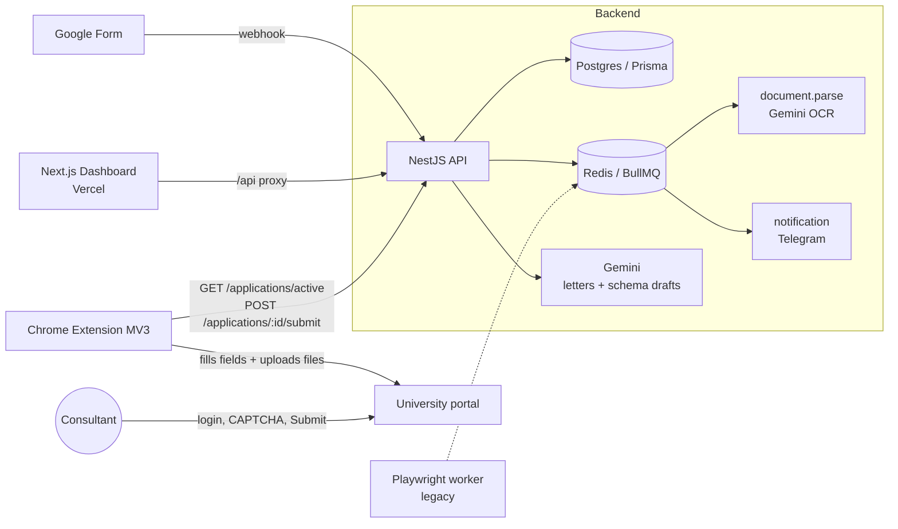

# LotsApply

LotsApply — end-to-end university application automation platform for international students applying to world-wide universities. Students submit their data and documents via Google Form. The system parses uploaded documents (passport, transcripts, etc.) using Gemini OCR, stores structured profiles, and auto-generates motivation letters.

**Problem:** an agency consultant re-types the same student profile into dozens of heterogeneous university portals (multi-step wizards, login walls, CAPTCHA). **Solution:** collect the profile once, then let a browser extension fill every portal from a per-university schema while the consultant only handles login and the final Submit.

<!-- TODO: 30–60s demo GIF: extension filling a university application form -->


**Live demo:** <!-- TODO: Vercel dashboard URL --> · **Test account:** <!-- TODO: email / password -->

## Architecture



| App / package | Path | Role |
|---|---|---|
| API | `apps/api` | NestJS REST + WebSocket |
| Dashboard | `apps/dashboard` | Next.js UI for agency and students |
| Extension | `apps/extension` | Chrome Extension, semi-automatic form filling |
| Worker | `apps/worker` | Playwright worker (legacy, recon only) |
| Database | `packages/database` | Prisma schema and client |
| Shared | `packages/shared` | Shared types (`StudentProfile`, `UniversitySchema`, queue names) |

## Key engineering decisions

1. **Human-in-the-loop over full automation** — login walls, CAPTCHA and CSRF made headless submission unreliable, so the extension automates field filling and file upload while the consultant logs in and clicks Submit. The submit is real and verifiable instead of a script's guess. [ADR-004](adr/adr-004-semi-auto-extension-over-full-automation.md)
2. **Deterministic first, LLM agent as fallback** — forms are filled from schema selectors and `mapsTo` paths; a Gemini semantic mapper or an observe → plan → act agent takes over only when the deterministic path fails (`FORM_FILL_MODE`, `AGENT_FALLBACK`). See [docs/api.md](docs/api.md#autofill-modes).
3. **Resume after re-login** — session expiry and CAPTCHA pause an application (`waiting_for_login` / `attention_required`) instead of burning retries; after re-login, paused applications are re-enqueued and the wizard resumes from the current step.
4. **University knowledge as data, not code** — each portal is a `UniversitySchema` JSON (selectors, field mappings, wizard steps), so onboarding a university needs no migration and no new code. [ADR-002](adr/adr-002-postgres-prisma-domain-model.md)
5. **LLM output is always a draft** — generated letters need consultant approval; generated university schemas go through a mandatory review checklist before going live. [ADR-005](adr/adr-005-gemini-for-letter-and-schema-generation.md)
6. **Slow I/O off the request path** — OCR parsing, notifications and application processing run on BullMQ queues. [ADR-003](adr/adr-003-redis-bullmq-async-processing.md)

## Results

<!-- TODO (stage 3): real numbers — e.g. universities onboarded, fields auto-filled per form, time per application before/after, fill success rate -->

## Quick start

```bash
docker compose up --build
```

Starts the API (`localhost:3000`), the worker, Postgres (`localhost:5433`) and Redis. Secrets (`GEMINI_API_KEY`, R2, Telegram) go into `apps/api/.env` and `apps/worker/.env` — see `.env.example` in each app.

Dashboard and extension run separately:

```bash
pnpm install
cd apps/dashboard && pnpm run dev
pnpm --filter @uni-apply/shared build && cd apps/extension && pnpm run build
```

## Known limitations & next steps

- **Not fully automatic by design.** A consultant must log in, solve CAPTCHA and click Submit on every portal.
- **Per-university onboarding.** Every new portal needs a captured and reviewed `UniversitySchema`; there is no universal "any form" engine.
- **Most agency CRUD endpoints are not behind auth guards yet** — only extension routes and `/students/me*` are protected.
- **Single LLM provider.** A Gemini outage blocks OCR, letter generation and schema drafting; there is no fallback provider.
- **Loose DB integrity.** `UniversitySchema.fields` is untyped JSON and several `universityId` references have no FK; integrity is enforced in application code.
- **Two form-filling runtimes** (extension + legacy Playwright worker) still coexist.

## Documentation

| Document | Path |
|---|---|
| Technical reference: DB schema, API routes, worker pipeline | [docs/api.md](docs/api.md) |
| Architecture decisions | [adr/](adr/) |
| Architecture notes | [docs/architecture-notes/](docs/architecture-notes/) |
| University onboarding | [docs/university-onboarding.md](docs/university-onboarding.md) |
| Specs | [specs/](specs/) |
| Per-app README | `apps/{api,dashboard,extension,worker}/README.md` |

## License

Proprietary — all rights reserved. See [LICENSE](LICENSE).
